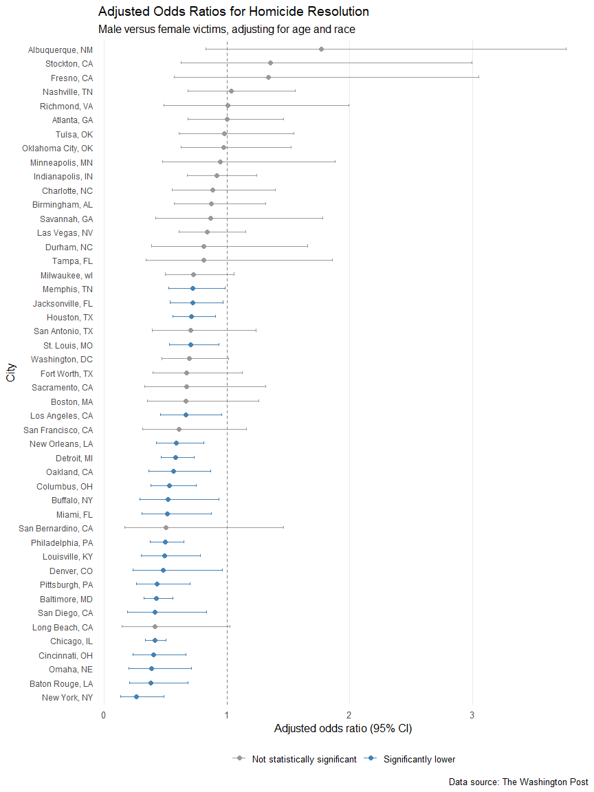

P8105 Homework 6
================
Yikai Lu

``` r
dir.create("data", showWarnings = FALSE)

file.rename(
  "homicide-data.csv",
  "data/homicide-data.csv"
)
```

    ## [1] FALSE

# Problem 1

## Data import and cleaning

``` r
homicide_df =
  read_csv("data/homicide-data.csv")

dim(homicide_df)
```

    ## [1] 52179    12

``` r
homicide_df =
  read_csv(
    "data/homicide-data.csv",
    na = c("", "NA", "Unknown")
  ) |>
  mutate(
    city_state = str_c(city, state, sep = ", "),
    resolved = if_else(disposition == "Closed by arrest", 1, 0),
    victim_age = as.numeric(victim_age)
  ) |>
  filter(
    !city_state %in% c(
      "Dallas, TX",
      "Phoenix, AZ",
      "Kansas City, MO",
      "Tulsa, AL"
    ),
    victim_race %in% c("White", "Black")
  ) |>
  mutate(
    victim_sex = factor(victim_sex, levels = c("Female", "Male")),
    victim_race = factor(victim_race, levels = c("White", "Black"))
  )
```

After data cleaning, the dataset contains 39693 homicide records across
47 cities. Among these records, 48.9% were resolved through arrest. The
analysis is restricted to White and Black victims, with female victims
serving as the reference group for the subsequent logistic regression
analysis.

## Logistic regression for Baltimore

We first fit a logistic regression model for Baltimore, MD, using
homicide resolution as the binary outcome and victim age, sex, and race
as predictors. The model estimates the association between victim sex
and homicide resolution, adjusting for victim age and race.

``` r
baltimore_df =
  homicide_df |>
  filter(city_state == "Baltimore, MD")

baltimore_fit =
  glm(
    resolved ~ victim_age + victim_sex + victim_race,
    data = baltimore_df,
    family = binomial(link = "logit")
  )
```

``` r
#extract the OR and 95% CI
baltimore_results =
  baltimore_fit |>
  broom::tidy(
    conf.int = TRUE,
    conf.level = 0.95,
    exponentiate = TRUE
  ) |>
  filter(term == "victim_sexMale") |>
  select(estimate, conf.low, conf.high)

baltimore_results |>
  knitr::kable(
    digits = 3,
    col.names = c(
      "Adjusted OR",
      "95% CI Lower",
      "95% CI Upper"
    )
  )
```

| Adjusted OR | 95% CI Lower | 95% CI Upper |
|------------:|-------------:|-------------:|
|       0.426 |        0.324 |        0.558 |

In Baltimore, the adjusted odds ratio for homicide resolution comparing
male victims to female victims is 0.426 (95% CI: 0.324 to 0.558). After
adjusting for victim age and race, homicides involving male victims have
approximately 57.4% lower odds of resolution than those involving female
victims. The association is statistically significant because the 95%
confidence interval does not include 1.

## Logistic regression across cities

We extend the Baltimore analysis to all cities in the cleaned dataset by
fitting separate logistic regression models for each city. Each model
estimates the adjusted odds ratio for homicide resolution comparing male
victims to female victims, controlling for victim age and race.

``` r
city_results =
  homicide_df |>
  nest(data = -city_state) |>
  mutate(
    model = map(
      data,
      \(df) glm(
        resolved ~ victim_age + victim_sex + victim_race,
        data = df,
        family = binomial(link = "logit")
      )
    ),
    results = map(
      model,
      \(fit) broom::tidy(
        fit,
        conf.int = TRUE,
        conf.level = 0.95,
        exponentiate = TRUE
      )
    )
  ) |>
  select(city_state, results) |>
  unnest(results) |>
  filter(term == "victim_sexMale") |>
  select(city_state, estimate, conf.low, conf.high) |>
  arrange(estimate)
```

``` r
dim(city_results)
```

    ## [1] 47  4

``` r
city_results |>
  head(10) |>
  knitr::kable(digits = 3)
```

| city_state      | estimate | conf.low | conf.high |
|:----------------|---------:|---------:|----------:|
| New York, NY    |    0.262 |    0.133 |     0.485 |
| Baton Rouge, LA |    0.381 |    0.204 |     0.684 |
| Omaha, NE       |    0.382 |    0.199 |     0.711 |
| Cincinnati, OH  |    0.400 |    0.231 |     0.667 |
| Chicago, IL     |    0.410 |    0.336 |     0.501 |
| Long Beach, CA  |    0.410 |    0.143 |     1.024 |
| San Diego, CA   |    0.413 |    0.191 |     0.830 |
| Baltimore, MD   |    0.426 |    0.324 |     0.558 |
| Pittsburgh, PA  |    0.431 |    0.263 |     0.696 |
| Denver, CO      |    0.479 |    0.233 |     0.962 |

## Visualization of adjusted odds ratios

To compare the association between victim sex and homicide resolution
across cities, we create a forest plot displaying the adjusted odds
ratios and their 95% confidence intervals. Cities are ordered by their
estimated odds ratios, and a reference line at OR = 1 indicates equal
adjusted odds of resolution for male and female victims.

``` r
city_results |>
  mutate(
    city_state = fct_reorder(city_state, estimate),
    significance = case_when(
      conf.high < 1 ~ "Significantly lower",
      conf.low > 1 ~ "Significantly higher",
      TRUE ~ "Not statistically significant"
    )
  ) |>
  ggplot(
    aes(
      x = estimate,
      y = city_state,
      color = significance
    )
  ) +
  geom_vline(
    xintercept = 1,
    linetype = "dashed",
    color = "gray50"
  ) +
  geom_errorbar(
    aes(xmin = conf.low, xmax = conf.high),
    orientation = "y",
    width = 0.2
  ) +
  geom_point(size = 2) +
  scale_color_manual(
    values = c(
      "Significantly lower" = "steelblue",
      "Significantly higher" = "firebrick",
      "Not statistically significant" = "gray60"
    )
  ) +
  labs(
    title = "Adjusted Odds Ratios for Homicide Resolution",
    subtitle = "Male versus female victims, adjusting for age and race",
    x = "Adjusted odds ratio (95% CI)",
    y = "City",
    color = NULL,
    caption = "Data source: The Washington Post"
  ) +
  theme_minimal(base_size = 12) +
  theme(
    legend.position = "bottom",
    axis.text.y = element_text(size = 9),
    panel.grid.major.y = element_blank(),
    panel.grid.minor = element_blank()
  )
```

<!-- -->

``` r
#Final statistic 
city_summary =
  city_results |>
  summarize(
    n_cities = n(),
    n_lower_or = sum(estimate < 1),
    n_higher_or = sum(estimate > 1),
    n_significant_lower = sum(conf.high < 1),
    n_significant_higher = sum(conf.low > 1),
    n_not_significant = sum(conf.low <= 1 & conf.high >= 1)
  )

city_summary |>
  knitr::kable()
```

| n_cities | n_lower_or | n_higher_or | n_significant_lower | n_significant_higher | n_not_significant |
|---:|---:|---:|---:|---:|---:|
| 47 | 41 | 6 | 22 | 0 | 25 |

The forest plot shows that 41 of the 47 cities (87.2%) have estimated
adjusted odds ratios below 1, suggesting lower odds of homicide
resolution for male victims after adjusting for age and race.

Among all cities, 22 have 95% confidence intervals entirely below 1,
while 0 have confidence intervals entirely above 1. The remaining 25
cities have confidence intervals that include 1.

New York has the lowest estimated adjusted odds ratio (0.262), while
Albuquerque has the highest (1.767). The widths of the confidence
intervals vary across cities, indicating differences in the precision of
the estimates.

Overall, homicides involving male victims tend to have lower adjusted
odds of resolution than those involving female victims, although the
magnitude and statistical significance of this association vary across
cities.
