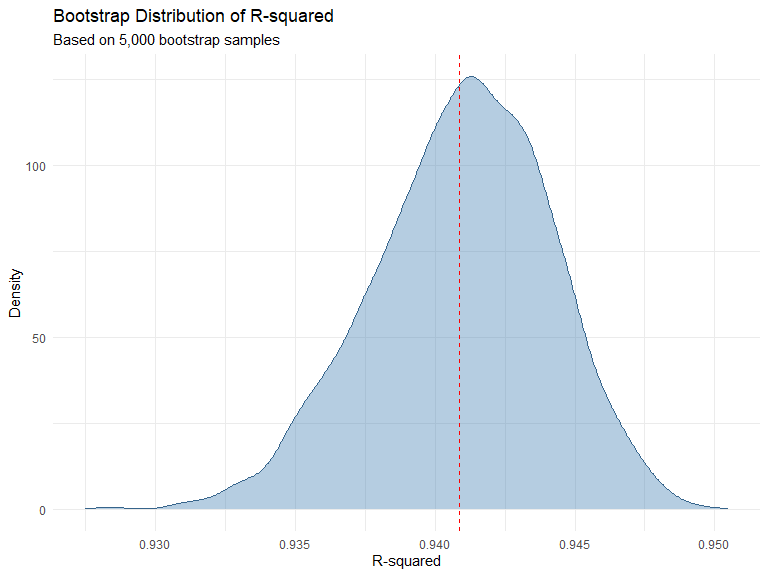
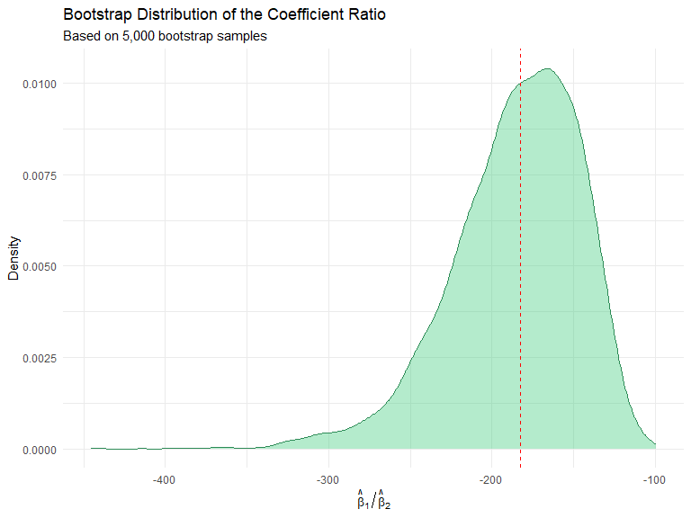
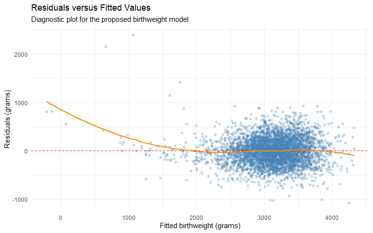
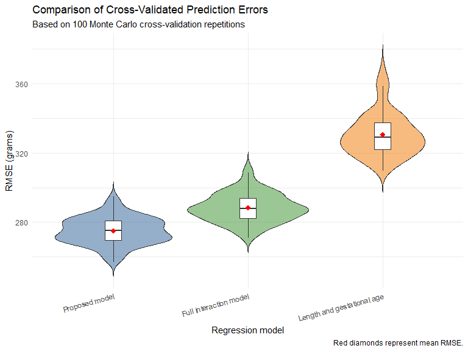

P8105 Homework 6
================
Yikai Lu

``` r
dir.create("data", showWarnings = FALSE)

file.rename(
  "homicide-data.csv",
  "data/homicide-data.csv"
)
```

    ## [1] FALSE

# Problem 1

## Data import and cleaning

``` r
homicide_df =
  read_csv("data/homicide-data.csv")

dim(homicide_df)
```

    ## [1] 52179    12

``` r
homicide_df =
  read_csv(
    "data/homicide-data.csv",
    na = c("", "NA", "Unknown")
  ) |>
  mutate(
    city_state = str_c(city, state, sep = ", "),
    resolved = if_else(disposition == "Closed by arrest", 1, 0),
    victim_age = as.numeric(victim_age)
  ) |>
  filter(
    !city_state %in% c(
      "Dallas, TX",
      "Phoenix, AZ",
      "Kansas City, MO",
      "Tulsa, AL"
    ),
    victim_race %in% c("White", "Black")
  ) |>
  mutate(
    victim_sex = factor(victim_sex, levels = c("Female", "Male")),
    victim_race = factor(victim_race, levels = c("White", "Black"))
  )
```

After data cleaning, the dataset contains 39693 homicide records across
47 cities. Among these records, 48.9% were resolved through arrest. The
analysis is restricted to White and Black victims, with female victims
serving as the reference group for the subsequent logistic regression
analysis.

## Logistic regression for Baltimore

We first fit a logistic regression model for Baltimore, MD, using
homicide resolution as the binary outcome and victim age, sex, and race
as predictors. The model estimates the association between victim sex
and homicide resolution, adjusting for victim age and race.

``` r
baltimore_df =
  homicide_df |>
  filter(city_state == "Baltimore, MD")

baltimore_fit =
  glm(
    resolved ~ victim_age + victim_sex + victim_race,
    data = baltimore_df,
    family = binomial(link = "logit")
  )
```

``` r
#extract the OR and 95% CI
baltimore_results =
  baltimore_fit |>
  broom::tidy(
    conf.int = TRUE,
    conf.level = 0.95,
    exponentiate = TRUE
  ) |>
  filter(term == "victim_sexMale") |>
  select(estimate, conf.low, conf.high)

baltimore_results |>
  knitr::kable(
    digits = 3,
    col.names = c(
      "Adjusted OR",
      "95% CI Lower",
      "95% CI Upper"
    )
  )
```

| Adjusted OR | 95% CI Lower | 95% CI Upper |
|------------:|-------------:|-------------:|
|       0.426 |        0.324 |        0.558 |

In Baltimore, the adjusted odds ratio for homicide resolution comparing
male victims to female victims is 0.426 (95% CI: 0.324 to 0.558). After
adjusting for victim age and race, homicides involving male victims have
approximately 57.4% lower odds of resolution than those involving female
victims. The association is statistically significant because the 95%
confidence interval does not include 1.

## Logistic regression across cities

We extend the Baltimore analysis to all cities in the cleaned dataset by
fitting separate logistic regression models for each city. Each model
estimates the adjusted odds ratio for homicide resolution comparing male
victims to female victims, controlling for victim age and race.

``` r
city_results =
  homicide_df |>
  nest(data = -city_state) |>
  mutate(
    model = map(
      data,
      \(df) glm(
        resolved ~ victim_age + victim_sex + victim_race,
        data = df,
        family = binomial(link = "logit")
      )
    ),
    results = map(
      model,
      \(fit) broom::tidy(
        fit,
        conf.int = TRUE,
        conf.level = 0.95,
        exponentiate = TRUE
      )
    )
  ) |>
  select(city_state, results) |>
  unnest(results) |>
  filter(term == "victim_sexMale") |>
  select(city_state, estimate, conf.low, conf.high) |>
  arrange(estimate)
```

``` r
dim(city_results)
```

    ## [1] 47  4

``` r
city_results |>
  head(10) |>
  knitr::kable(digits = 3)
```

| city_state      | estimate | conf.low | conf.high |
|:----------------|---------:|---------:|----------:|
| New York, NY    |    0.262 |    0.133 |     0.485 |
| Baton Rouge, LA |    0.381 |    0.204 |     0.684 |
| Omaha, NE       |    0.382 |    0.199 |     0.711 |
| Cincinnati, OH  |    0.400 |    0.231 |     0.667 |
| Chicago, IL     |    0.410 |    0.336 |     0.501 |
| Long Beach, CA  |    0.410 |    0.143 |     1.024 |
| San Diego, CA   |    0.413 |    0.191 |     0.830 |
| Baltimore, MD   |    0.426 |    0.324 |     0.558 |
| Pittsburgh, PA  |    0.431 |    0.263 |     0.696 |
| Denver, CO      |    0.479 |    0.233 |     0.962 |

## Visualization of adjusted odds ratios

To compare the association between victim sex and homicide resolution
across cities, we create a forest plot displaying the adjusted odds
ratios and their 95% confidence intervals. Cities are ordered by their
estimated odds ratios, and a reference line at OR = 1 indicates equal
adjusted odds of resolution for male and female victims.

``` r
city_results |>
  mutate(
    city_state = fct_reorder(city_state, estimate),
    significance = case_when(
      conf.high < 1 ~ "Significantly lower",
      conf.low > 1 ~ "Significantly higher",
      TRUE ~ "Not statistically significant"
    )
  ) |>
  ggplot(
    aes(
      x = estimate,
      y = city_state,
      color = significance
    )
  ) +
  geom_vline(
    xintercept = 1,
    linetype = "dashed",
    color = "gray50"
  ) +
  geom_errorbar(
    aes(xmin = conf.low, xmax = conf.high),
    orientation = "y",
    width = 0.2
  ) +
  geom_point(size = 2) +
  scale_color_manual(
    values = c(
      "Significantly lower" = "steelblue",
      "Significantly higher" = "firebrick",
      "Not statistically significant" = "gray60"
    )
  ) +
  labs(
    title = "Adjusted Odds Ratios for Homicide Resolution",
    subtitle = "Male versus female victims, adjusting for age and race",
    x = "Adjusted odds ratio (95% CI)",
    y = "City",
    color = NULL,
    caption = "Data source: The Washington Post"
  ) +
  theme_minimal(base_size = 12) +
  theme(
    legend.position = "bottom",
    axis.text.y = element_text(size = 9),
    panel.grid.major.y = element_blank(),
    panel.grid.minor = element_blank()
  )
```

<!-- -->

``` r
#Final statistic 
city_summary =
  city_results |>
  summarize(
    n_cities = n(),
    n_lower_or = sum(estimate < 1),
    n_higher_or = sum(estimate > 1),
    n_significant_lower = sum(conf.high < 1),
    n_significant_higher = sum(conf.low > 1),
    n_not_significant = sum(conf.low <= 1 & conf.high >= 1)
  )

city_summary |>
  knitr::kable()
```

| n_cities | n_lower_or | n_higher_or | n_significant_lower | n_significant_higher | n_not_significant |
|---:|---:|---:|---:|---:|---:|
| 47 | 41 | 6 | 22 | 0 | 25 |

The forest plot shows that 41 of the 47 cities (87.2%) have estimated
adjusted odds ratios below 1, suggesting lower odds of homicide
resolution for male victims after adjusting for age and race.

Among all cities, 22 have 95% confidence intervals entirely below 1,
while 0 have confidence intervals entirely above 1. The remaining 25
cities have confidence intervals that include 1.

New York has the lowest estimated adjusted odds ratio (0.262), while
Albuquerque has the highest (1.767). The widths of the confidence
intervals vary across cities, indicating differences in the precision of
the estimates.

Overall, homicides involving male victims tend to have lower adjusted
odds of resolution than those involving female victims, although the
magnitude and statistical significance of this association vary across
cities.

\#Problem 2

``` r
library(p8105.datasets)
library(tidyverse)
library(broom)
library(p8105.datasets)
```

## Data import and preparation

``` r
data("weather_df")

weather_df =
  weather_df |>
  select(tmax, tmin, prcp) |>
  drop_na()

weather_df |>
  head() |>
  knitr::kable()
```

| tmax | tmin | prcp |
|-----:|-----:|-----:|
|  4.4 |  0.6 |  157 |
| 10.6 |  2.2 |   13 |
|  3.3 |  1.1 |   56 |
|  6.1 |  1.7 |    5 |
|  5.6 |  2.2 |    0 |
|  5.0 |  1.1 |    0 |

``` r
dim(weather_df)
```

    ## [1] 2171    3

``` r
summary(weather_df)
```

    ##       tmax             tmin            prcp        
    ##  Min.   :-11.40   Min.   :-19.6   Min.   :   0.00  
    ##  1st Qu.:  7.20   1st Qu.:  0.5   1st Qu.:   0.00  
    ##  Median : 20.60   Median : 11.1   Median :   0.00  
    ##  Mean   : 17.87   Mean   : 10.1   Mean   :  32.81  
    ##  3rd Qu.: 28.30   3rd Qu.: 20.6   3rd Qu.:  15.00  
    ##  Max.   : 36.70   Max.   : 26.1   Max.   :1811.00

## Original linear regression model

We first fit a linear regression model using the original weather
dataset to obtain reference estimates for the subsequent bootstrap
analysis.

``` r
weather_fit =
  lm(
    tmax ~ tmin + prcp,
    data = weather_df
  )

weather_fit |>
  broom::tidy() |>
  knitr::kable(digits = 4)
```

| term        | estimate | std.error | statistic | p.value |
|:------------|---------:|----------:|----------:|--------:|
| (Intercept) |   7.7756 |    0.0854 |   91.0432 |       0 |
| tmin        |   1.0175 |    0.0056 |  182.2986 |       0 |
| prcp        |  -0.0056 |    0.0006 |   -9.4112 |       0 |

``` r
original_r_squared =
  weather_fit |>
  broom::glance() |>
  pull(r.squared)

original_ratio =
  weather_fit |>
  broom::tidy() |>
  select(term, estimate) |>
  pivot_wider(
    names_from = term,
    values_from = estimate
  ) |>
  mutate(beta_ratio = tmin / prcp) |>
  pull(beta_ratio)

tibble(
  r_squared = original_r_squared,
  beta_ratio = original_ratio
) |>
  knitr::kable(digits = 4)
```

| r_squared | beta_ratio |
|----------:|-----------:|
|    0.9409 |  -182.4002 |

``` r
#create bootstrap result
boot_sample = function(df) {
  slice_sample(
    df,
    n = nrow(df),
    replace = TRUE
  )
}

boot_sample = function(df) {
  slice_sample(
    df,
    n = nrow(df),
    replace = TRUE
  )
}
```

``` r
set.seed(123)

bootstrap_results =
  tibble(bootstrap_id = 1:5000) |>
  mutate(
    boot_sample = map(
      bootstrap_id,
      \(i) boot_sample(weather_df)
    ),
    model = map(
      boot_sample,
      \(df) lm(tmax ~ tmin + prcp, data = df)
    ),
    r_squared = map_dbl(
      model,
      \(fit) broom::glance(fit) |> pull(r.squared)
    ),
    coefficients = map(
      model,
      \(fit) broom::tidy(fit)
    )
  ) |>
  select(bootstrap_id, r_squared, coefficients) |>
  unnest(coefficients) |>
  select(bootstrap_id, r_squared, term, estimate) |>
  pivot_wider(
    names_from = term,
    values_from = estimate
  ) |>
  mutate(beta_ratio = tmin / prcp) |>
  select(bootstrap_id, r_squared, beta_ratio)

dim(bootstrap_results)
```

    ## [1] 5000    3

``` r
bootstrap_results |>
  head(10) |>
  knitr::kable(digits = 4)
```

| bootstrap_id | r_squared | beta_ratio |
|-------------:|----------:|-----------:|
|            1 |    0.9363 |  -157.6573 |
|            2 |    0.9391 |  -216.6132 |
|            3 |    0.9431 |  -158.8452 |
|            4 |    0.9464 |  -196.2256 |
|            5 |    0.9409 |  -141.5926 |
|            6 |    0.9411 |  -141.7487 |
|            7 |    0.9425 |  -122.0097 |
|            8 |    0.9403 |  -140.0315 |
|            9 |    0.9397 |  -194.1092 |
|           10 |    0.9392 |  -211.8242 |

``` r
bootstrap_results |>
  summarize(
    invalid_r_squared = sum(!is.finite(r_squared)),
    invalid_beta_ratio = sum(!is.finite(beta_ratio))
  ) |>
  knitr::kable()
```

| invalid_r_squared | invalid_beta_ratio |
|------------------:|-------------------:|
|                 0 |                  0 |

## Bootstrap distributions

We visualize the bootstrap distributions of R-squared and the
coefficient ratio to examine their shapes, centers, and variability. The
dashed vertical lines represent the estimates obtained from the original
dataset.

``` r
bootstrap_results |>
  ggplot(aes(x = r_squared)) +
  geom_density(
    fill = "steelblue",
    color = "steelblue4",
    alpha = 0.4
  ) +
  geom_vline(
    xintercept = original_r_squared,
    color = "red",
    linetype = "dashed"
  ) +
  labs(
    title = "Bootstrap Distribution of R-squared",
    subtitle = "Based on 5,000 bootstrap samples",
    x = "R-squared",
    y = "Density"
  ) +
  theme_minimal()
```

<!-- -->

``` r
bootstrap_results |>
  ggplot(aes(x = beta_ratio)) +
  geom_density(
    fill = "seagreen3",
    color = "seagreen4",
    alpha = 0.4
  ) +
  geom_vline(
    xintercept = original_ratio,
    color = "red",
    linetype = "dashed"
  ) +
  labs(
    title = "Bootstrap Distribution of the Coefficient Ratio",
    subtitle = "Based on 5,000 bootstrap samples",
    x = expression(hat(beta)[1] / hat(beta)[2]),
    y = "Density"
  ) +
  theme_minimal()
```

<!-- -->
\## Bootstrap confidence intervals

We construct 95% percentile-based bootstrap confidence intervals using
the 2.5th and 97.5th percentiles of the bootstrap distributions for both
statistics.

``` r
bootstrap_ci =
  bootstrap_results |>
  pivot_longer(
    cols = c(r_squared, beta_ratio),
    names_to = "statistic",
    values_to = "estimate"
  ) |>
  group_by(statistic) |>
  summarize(
    bootstrap_mean = mean(estimate),
    bootstrap_se = sd(estimate),
    conf.low = quantile(estimate, 0.025),
    conf.high = quantile(estimate, 0.975),
    .groups = "drop"
  )

bootstrap_ci |>
  knitr::kable(
    digits = 4,
    col.names = c(
      "Statistic",
      "Bootstrap Mean",
      "Bootstrap SE",
      "95% CI Lower",
      "95% CI Upper"
    ),
    caption = "95% percentile-based bootstrap confidence intervals"
  )
```

| Statistic  | Bootstrap Mean | Bootstrap SE | 95% CI Lower | 95% CI Upper |
|:-----------|---------------:|-------------:|-------------:|-------------:|
| beta_ratio |      -185.4894 |      39.8224 |    -277.1703 |    -125.7063 |
| r_squared  |         0.9409 |       0.0032 |       0.9344 |       0.9466 |

95% percentile-based bootstrap confidence intervals

``` r
r_squared_ci =
  bootstrap_ci |>
  filter(statistic == "r_squared")

beta_ratio_ci =
  bootstrap_ci |>
  filter(statistic == "beta_ratio")
```

## Final interpretation

Based on 5000 bootstrap samples, the bootstrap distribution of R-squared
is tightly concentrated around its original estimate of 0.9409, with a
bootstrap mean of 0.9409 and a standard error of 0.0032. The 95%
bootstrap confidence interval is (0.9344, 0.9466). The narrow confidence
interval suggests that the estimated proportion of variation in maximum
temperature explained by the model is relatively stable across bootstrap
samples.

The bootstrap distribution of the coefficient ratio is unimodal and
negatively skewed, with a longer tail toward more negative values. The
original estimate is -182.4002, while the bootstrap mean is -185.4894.
The 95% bootstrap confidence interval is (-277.1703, -125.7063). The
asymmetric distribution illustrates the usefulness of percentile-based
bootstrap confidence intervals when a normal approximation may be
inappropriate.

Overall, the regression model explains a large proportion of the
observed variation in maximum temperature. Bootstrap resampling provides
an empirical approach to quantifying uncertainty in both R-squared and
the ratio of regression coefficients without requiring a normal sampling
distribution.

# Problem 3

## Data import and cleaning

We investigate factors associated with infant birthweight using multiple
linear regression and compare the predictive performance of three
regression models using cross-validation.

``` r
birthweight_df =
  read_csv("data/birthweight.csv") |>
  janitor::clean_names() |>
  mutate(
    babysex = factor(
      babysex,
      levels = c(1, 2),
      labels = c("Male", "Female")
    ),
    frace = factor(
      frace,
      levels = c(1, 2, 3, 4, 8, 9),
      labels = c(
        "White", "Black", "Asian",
        "Puerto Rican", "Other", "Unknown"
      )
    ),
    mrace = factor(
      mrace,
      levels = c(1, 2, 3, 4, 8),
      labels = c(
        "White", "Black", "Asian",
        "Puerto Rican", "Other"
      )
    ),
    malform = factor(
      malform,
      levels = c(0, 1),
      labels = c("Absent", "Present")
    )
  )

dim(birthweight_df)
```

    ## [1] 4342   20

``` r
glimpse(birthweight_df)
```

    ## Rows: 4,342
    ## Columns: 20
    ## $ babysex  <fct> Female, Male, Female, Male, Female, Male, Female, Female, Mal…
    ## $ bhead    <dbl> 34, 34, 36, 34, 34, 33, 33, 33, 36, 33, 35, 35, 35, 36, 35, 3…
    ## $ blength  <dbl> 51, 48, 50, 52, 52, 52, 46, 49, 52, 50, 51, 51, 48, 53, 51, 4…
    ## $ bwt      <dbl> 3629, 3062, 3345, 3062, 3374, 3374, 2523, 2778, 3515, 3459, 3…
    ## $ delwt    <dbl> 177, 156, 148, 157, 156, 129, 126, 140, 146, 169, 130, 146, 1…
    ## $ fincome  <dbl> 35, 65, 85, 55, 5, 55, 96, 5, 85, 75, 55, 55, 75, 75, 65, 75,…
    ## $ frace    <fct> White, Black, White, White, White, White, Black, White, White…
    ## $ gaweeks  <dbl> 39.9, 25.9, 39.9, 40.0, 41.6, 40.7, 40.3, 37.4, 40.3, 40.7, 4…
    ## $ malform  <fct> Absent, Absent, Absent, Absent, Absent, Absent, Absent, Absen…
    ## $ menarche <dbl> 13, 14, 12, 14, 13, 12, 14, 12, 11, 12, 13, 12, 13, 11, 12, 1…
    ## $ mheight  <dbl> 63, 65, 64, 64, 66, 66, 72, 62, 61, 64, 67, 62, 64, 68, 62, 6…
    ## $ momage   <dbl> 36, 25, 29, 18, 20, 23, 29, 19, 13, 19, 23, 16, 28, 23, 21, 1…
    ## $ mrace    <fct> White, Black, White, White, White, White, Black, White, White…
    ## $ parity   <dbl> 3, 0, 0, 0, 0, 0, 0, 0, 0, 0, 0, 0, 0, 0, 0, 0, 0, 0, 0, 0, 0…
    ## $ pnumlbw  <dbl> 0, 0, 0, 0, 0, 0, 0, 0, 0, 0, 0, 0, 0, 0, 0, 0, 0, 0, 0, 0, 0…
    ## $ pnumsga  <dbl> 0, 0, 0, 0, 0, 0, 0, 0, 0, 0, 0, 0, 0, 0, 0, 0, 0, 0, 0, 0, 0…
    ## $ ppbmi    <dbl> 26.27184, 21.34485, 23.56517, 21.84508, 21.02642, 18.60030, 1…
    ## $ ppwt     <dbl> 148, 128, 137, 127, 130, 115, 105, 119, 105, 145, 110, 115, 1…
    ## $ smoken   <dbl> 0.000, 0.000, 1.000, 10.000, 1.000, 0.000, 0.000, 0.000, 0.00…
    ## $ wtgain   <dbl> 29, 28, 11, 30, 26, 14, 21, 21, 41, 24, 20, 31, 23, 21, 24, 2…

``` r
missing_summary =
  birthweight_df |>
  summarize(
    across(everything(), ~ sum(is.na(.x)))
  ) |>
  pivot_longer(
    everything(),
    names_to = "variable",
    values_to = "n_missing"
  )

missing_summary |>
  knitr::kable(
    col.names = c("Variable", "Missing observations"),
    caption = "Missing data summary"
  )
```

| Variable | Missing observations |
|:---------|---------------------:|
| babysex  |                    0 |
| bhead    |                    0 |
| blength  |                    0 |
| bwt      |                    0 |
| delwt    |                    0 |
| fincome  |                    0 |
| frace    |                    0 |
| gaweeks  |                    0 |
| malform  |                    0 |
| menarche |                    0 |
| mheight  |                    0 |
| momage   |                    0 |
| mrace    |                    0 |
| parity   |                    0 |
| pnumlbw  |                    0 |
| pnumsga  |                    0 |
| ppbmi    |                    0 |
| ppwt     |                    0 |
| smoken   |                    0 |
| wtgain   |                    0 |

Missing data summary

``` r
sum(!complete.cases(birthweight_df))
```

    ## [1] 0

After data cleaning, the dataset contains 4342 observations and 20
variables. Infant sex, maternal race, paternal race, and the presence of
malformations were converted to categorical variables. The dataset
contains 0 missing values and 0 incomplete observations. Therefore, all
observations can be retained for the subsequent regression analysis.

## Proposed regression model

A hypothesis-driven approach was used to select predictors for the
proposed birthweight regression model. Infant sex, head circumference,
birth length, and gestational age were included to account for infant
size and development. Maternal smoking, pre-pregnancy BMI, pregnancy
weight gain, maternal age, and maternal race were included to account
for maternal behavioral, physiological, and demographic characteristics.

A multiple linear regression model was fitted using birthweight as the
continuous outcome and the selected predictors as main effects.

``` r
birthweight_fit =
  lm(
    bwt ~ babysex + bhead + blength + gaweeks +
      smoken + ppbmi + wtgain + momage + mrace,
    data = birthweight_df
  )

birthweight_fit |>
  broom::tidy(conf.int = TRUE) |>
  knitr::kable(
    digits = 3,
    caption = "Estimated coefficients for the proposed model"
  )
```

| term              |  estimate | std.error | statistic | p.value |  conf.low | conf.high |
|:------------------|----------:|----------:|----------:|--------:|----------:|----------:|
| (Intercept)       | -5776.905 |   102.770 |   -56.212 |   0.000 | -5978.387 | -5575.423 |
| babysexFemale     |    31.976 |     8.507 |     3.759 |   0.000 |    15.298 |    48.655 |
| bhead             |   132.094 |     3.466 |    38.106 |   0.000 |   125.298 |   138.890 |
| blength           |    76.476 |     2.019 |    37.872 |   0.000 |    72.517 |    80.435 |
| gaweeks           |    11.083 |     1.469 |     7.544 |   0.000 |     8.203 |    13.963 |
| smoken            |    -4.623 |     0.589 |    -7.854 |   0.000 |    -5.777 |    -3.469 |
| ppbmi             |     6.841 |     1.344 |     5.088 |   0.000 |     4.205 |     9.477 |
| wtgain            |     4.155 |     0.396 |    10.481 |   0.000 |     3.378 |     4.933 |
| momage            |     1.975 |     1.171 |     1.687 |   0.092 |    -0.320 |     4.269 |
| mraceBlack        |  -142.527 |     9.806 |   -14.535 |   0.000 |  -161.751 |  -123.302 |
| mraceAsian        |  -104.703 |    42.786 |    -2.447 |   0.014 |  -188.585 |   -20.820 |
| mracePuerto Rican |  -134.923 |    18.871 |    -7.150 |   0.000 |  -171.920 |   -97.926 |

Estimated coefficients for the proposed model

``` r
birthweight_fit |>
  broom::glance() |>
  select(r.squared, adj.r.squared, sigma, nobs) |>
  knitr::kable(
    digits = 4,
    col.names = c(
      "R-squared",
      "Adjusted R-squared",
      "Residual standard error",
      "Observations"
    ),
    caption = "Summary of proposed regression model"
  )
```

| R-squared | Adjusted R-squared | Residual standard error | Observations |
|----------:|-------------------:|------------------------:|-------------:|
|    0.7139 |             0.7132 |                274.2723 |         4342 |

Summary of proposed regression model

## Model diagnostics

``` r
birthweight_diagnostics =
  birthweight_df |>
  modelr::add_predictions(birthweight_fit) |>
  modelr::add_residuals(birthweight_fit)

birthweight_diagnostics |>
  select(bwt, pred, resid) |>
  head() |>
  knitr::kable(digits = 2)
```

|  bwt |    pred |   resid |
|-----:|--------:|--------:|
| 3629 | 3460.08 |  168.92 |
| 3062 | 2841.40 |  220.60 |
| 3345 | 3536.03 | -191.03 |
| 3062 | 3397.79 | -335.79 |
| 3374 | 3470.83 |  -96.83 |
| 3374 | 3240.87 |  133.13 |

``` r
birthweight_diagnostics |>
  ggplot(aes(x = pred, y = resid)) +
  geom_point(
    alpha = 0.25,
    color = "steelblue"
  ) +
  geom_hline(
    yintercept = 0,
    linetype = "dashed",
    color = "red"
  ) +
  geom_smooth(
    method = "loess",
    se = FALSE,
    color = "darkorange"
  ) +
  labs(
    title = "Residuals versus Fitted Values",
    subtitle = "Diagnostic plot for the proposed birthweight model",
    x = "Fitted birthweight (grams)",
    y = "Residuals (grams)"
  ) +
  theme_minimal()
```

<!-- -->
The residuals are generally centered around zero for most fitted
birthweights, suggesting that the proposed linear regression model
provides a reasonable fit for the majority of observations. However, the
smoothing curve deviates substantially from zero at lower fitted values,
indicating potential nonlinearity and systematic underprediction in this
region. Several large residuals and negative fitted birthweights are
also observed. The varying spread of residuals suggests potential
heteroscedasticity. These findings indicate that the model has
limitations, particularly for infants with extreme fitted birthweights.

## Alternative regression models

To evaluate the predictive performance of the proposed model, two
alternative regression models were fitted. The first includes birth
length and gestational age as main effects, while the second includes
head circumference, birth length, infant sex, and all possible
interactions among these three predictors.

``` r
length_age_fit =
  lm(
    bwt ~ blength + gaweeks,
    data = birthweight_df
  )

interaction_fit =
  lm(
    bwt ~ bhead * blength * babysex,
    data = birthweight_df
  )
```

``` r
model_comparison =
  tibble(
    model = c(
      "Proposed model",
      "Length and gestational age",
      "Full interaction model"
    ),
    fit = list(
      birthweight_fit,
      length_age_fit,
      interaction_fit
    )
  ) |>
  mutate(
    model_summary = map(fit, broom::glance)
  ) |>
  select(-fit) |>
  unnest(model_summary) |>
  select(model, r.squared, adj.r.squared, sigma)

model_comparison |>
  knitr::kable(
    digits = 4,
    col.names = c(
      "Model",
      "R-squared",
      "Adjusted R-squared",
      "Residual standard error"
    ),
    caption = "Comparison of regression model fit"
  )
```

| Model | R-squared | Adjusted R-squared | Residual standard error |
|:---|---:|---:|---:|
| Proposed model | 0.7139 | 0.7132 | 274.2723 |
| Length and gestational age | 0.5769 | 0.5767 | 333.2174 |
| Full interaction model | 0.6849 | 0.6844 | 287.7344 |

Comparison of regression model fit

``` r
set.seed(123)

cv_df =
  birthweight_df |>
  modelr::crossv_mc(100, test = 0.2) |>
  mutate(
    train = map(train, as_tibble),
    test = map(test, as_tibble)
  )

cv_df
```

    ## # A tibble: 100 × 3
    ##    train                 test                .id  
    ##    <list>                <list>              <chr>
    ##  1 <tibble [3,473 × 20]> <tibble [869 × 20]> 001  
    ##  2 <tibble [3,473 × 20]> <tibble [869 × 20]> 002  
    ##  3 <tibble [3,473 × 20]> <tibble [869 × 20]> 003  
    ##  4 <tibble [3,473 × 20]> <tibble [869 × 20]> 004  
    ##  5 <tibble [3,473 × 20]> <tibble [869 × 20]> 005  
    ##  6 <tibble [3,473 × 20]> <tibble [869 × 20]> 006  
    ##  7 <tibble [3,473 × 20]> <tibble [869 × 20]> 007  
    ##  8 <tibble [3,473 × 20]> <tibble [869 × 20]> 008  
    ##  9 <tibble [3,473 × 20]> <tibble [869 × 20]> 009  
    ## 10 <tibble [3,473 × 20]> <tibble [869 × 20]> 010  
    ## # ℹ 90 more rows

``` r
cv_df =
  cv_df |>
  mutate(
    proposed_mod = map(
      train,
      \(df) lm(formula(birthweight_fit), data = df)
    ),
    length_age_mod = map(
      train,
      \(df) lm(formula(length_age_fit), data = df)
    ),
    interaction_mod = map(
      train,
      \(df) lm(formula(interaction_fit), data = df)
    )
  )

cv_df
```

    ## # A tibble: 100 × 6
    ##    train    test     .id   proposed_mod length_age_mod interaction_mod
    ##    <list>   <list>   <chr> <list>       <list>         <list>         
    ##  1 <tibble> <tibble> 001   <lm>         <lm>           <lm>           
    ##  2 <tibble> <tibble> 002   <lm>         <lm>           <lm>           
    ##  3 <tibble> <tibble> 003   <lm>         <lm>           <lm>           
    ##  4 <tibble> <tibble> 004   <lm>         <lm>           <lm>           
    ##  5 <tibble> <tibble> 005   <lm>         <lm>           <lm>           
    ##  6 <tibble> <tibble> 006   <lm>         <lm>           <lm>           
    ##  7 <tibble> <tibble> 007   <lm>         <lm>           <lm>           
    ##  8 <tibble> <tibble> 008   <lm>         <lm>           <lm>           
    ##  9 <tibble> <tibble> 009   <lm>         <lm>           <lm>           
    ## 10 <tibble> <tibble> 010   <lm>         <lm>           <lm>           
    ## # ℹ 90 more rows

\#I want a better RMSE better predictive performance

``` r
cv_df =
  cv_df |>
  mutate(
    rmse_proposed = map2_dbl(
      proposed_mod, test, modelr::rmse
    ),
    rmse_length_age = map2_dbl(
      length_age_mod, test, modelr::rmse
    ),
    rmse_interaction = map2_dbl(
      interaction_mod, test, modelr::rmse
    )
  )

cv_df |>
  select(.id, starts_with("rmse_")) |>
  head(10) |>
  knitr::kable(digits = 3)
```

| .id | rmse_proposed | rmse_length_age | rmse_interaction |
|:----|--------------:|----------------:|-----------------:|
| 001 |       273.484 |         326.195 |          286.627 |
| 002 |       282.580 |         342.874 |          293.694 |
| 003 |       270.981 |         340.634 |          277.999 |
| 004 |       278.722 |         340.411 |          295.136 |
| 005 |       284.181 |         361.739 |          298.431 |
| 006 |       283.789 |         342.755 |          292.033 |
| 007 |       271.288 |         316.070 |          284.948 |
| 008 |       272.744 |         324.741 |          287.480 |
| 009 |       269.535 |         316.037 |          279.897 |
| 010 |       280.740 |         333.630 |          293.954 |

``` r
cv_summary =
  cv_df |>
  select(starts_with("rmse_")) |>
  pivot_longer(
    everything(),
    names_to = "model",
    values_to = "rmse"
  ) |>
  mutate(
    model = recode(
      model,
      rmse_proposed = "Proposed model",
      rmse_length_age = "Length and gestational age",
      rmse_interaction = "Full interaction model"
    )
  ) |>
  group_by(model) |>
  summarize(
    mean_rmse = mean(rmse),
    median_rmse = median(rmse),
    sd_rmse = sd(rmse),
    .groups = "drop"
  ) |>
  arrange(mean_rmse)

cv_summary |>
  knitr::kable(
    digits = 3,
    col.names = c(
      "Model",
      "Mean RMSE",
      "Median RMSE",
      "SD of RMSE"
    ),
    caption = "Comparison of cross-validated prediction errors"
  )
```

| Model                      | Mean RMSE | Median RMSE | SD of RMSE |
|:---------------------------|----------:|------------:|-----------:|
| Proposed model             |   275.094 |     275.309 |      7.791 |
| Full interaction model     |   288.385 |     287.862 |      8.244 |
| Length and gestational age |   330.709 |     329.082 |     12.633 |

Comparison of cross-validated prediction errors

## Comparison of cross-validated prediction errors

``` r
cv_plot_df =
  cv_df |>
  select(.id, starts_with("rmse_")) |>
  pivot_longer(
    cols = starts_with("rmse_"),
    names_to = "model",
    values_to = "rmse"
  ) |>
  mutate(
    model = recode(
      model,
      rmse_proposed = "Proposed model",
      rmse_length_age = "Length and gestational age",
      rmse_interaction = "Full interaction model"
    ),
    model = fct_reorder(model, rmse, .fun = median)
  )
```

``` r
cv_plot_df |>
  ggplot(aes(x = model, y = rmse, fill = model)) +
  geom_violin(
    alpha = 0.6,
    trim = FALSE
  ) +
  geom_boxplot(
    width = 0.12,
    fill = "white",
    outlier.shape = NA
  ) +
  stat_summary(
    fun = mean,
    geom = "point",
    shape = 18,
    size = 3,
    color = "red"
  ) +
  scale_fill_manual(
    values = c(
      "Proposed model" = "#4E79A7",
      "Full interaction model" = "#59A14F",
      "Length and gestational age" = "#F28E2B"
    )
  ) +
  labs(
    title = "Comparison of Cross-Validated Prediction Errors",
    subtitle = str_c(
      "Based on ", nrow(cv_df),
      " Monte Carlo cross-validation repetitions"
    ),
    x = "Regression model",
    y = "RMSE (grams)",
    caption = "Red diamonds represent mean RMSE."
  ) +
  theme_minimal() +
  theme(
    legend.position = "none",
    axis.text.x = element_text(
      angle = 15,
      hjust = 1
    )
  )
```

<!-- -->

``` r
proposed_cv =
  cv_summary |>
  filter(model == "Proposed model")

interaction_cv =
  cv_summary |>
  filter(model == "Full interaction model")

length_age_cv =
  cv_summary |>
  filter(model == "Length and gestational age")

improvement_simple =
  (length_age_cv$mean_rmse -
     proposed_cv$mean_rmse) /
  length_age_cv$mean_rmse

improvement_interaction =
  (interaction_cv$mean_rmse -
     proposed_cv$mean_rmse) /
  interaction_cv$mean_rmse
```

## Final interpretation

The proposed regression model explains 71.4% of the observed variation
in birthweight. The residuals are generally centered around zero for the
majority of observations. However, the residual plot shows curvature at
lower fitted values and several large residuals, suggesting that the
model may not adequately capture birthweight variation among some
observations.

Based on 100 Monte Carlo cross-validation repetitions, the proposed
model achieves the lowest mean RMSE of 275.09 grams, compared with
288.38 grams for the full interaction model and 330.71 grams for the
length and gestational age model.

The proposed model reduces mean prediction error by 16.8% relative to
the length and gestational age model and 4.6% relative to the full
interaction model.

The violin plot also shows that the proposed model has lower prediction
errors and less variability across repeated training and testing splits.

Overall, the proposed model provides the best predictive performance
among the three candidate models. Although the residual diagnostics
suggest some limitations, the cross-validation results support selecting
the proposed model for birthweight prediction.
